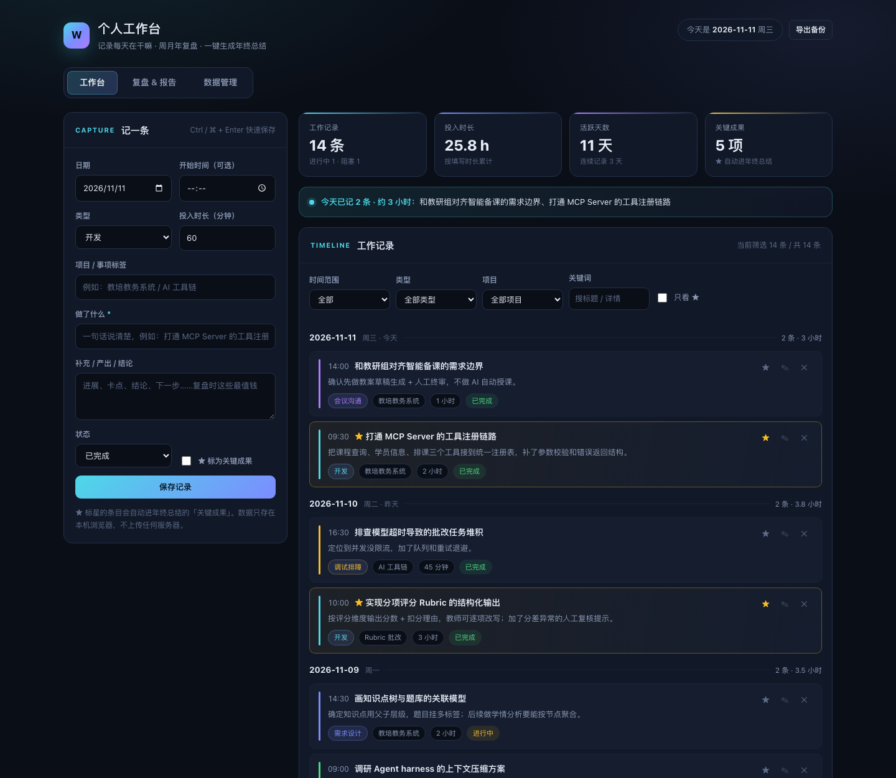
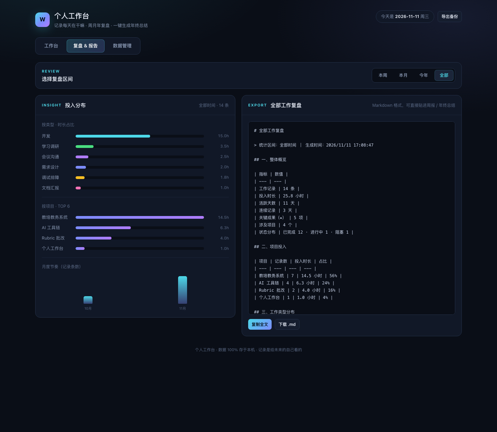

# 个人工作台 · Personal Workbench

> 一个零依赖、离线可用的单文件工作台：记录每天在干嘛，自动复盘，一键生成年终总结。

**在线使用**：https://jilijhao.github.io/personal-workbench/

也可以直接下载 `index.html` 双击打开，完全离线、无需安装任何东西。



## 为什么做这个

工作一忙就容易「想不起这周到底干了啥」，到了写周报、年终总结的时候只能靠回忆。这个工作台把记录成本压到 30 秒一条，剩下的统计、归类、成文全部交给页面自动完成。

设计上守三条底线：**零安装**（单文件 HTML）、**数据不出本机**（只写 localStorage，无账号、无后端、无埋点）、**能直接产出年终总结**（Markdown 一键复制 / 下载）。

## 功能

| 视图 | 能力 |
| --- | --- |
| 工作台 | 记录（日期 / 时间 / 类型 / 项目 / 时长 / 事项 / 补充 / 状态 / ★标星）、编辑、删除、标星；4 张统计卡（记录数 / 投入时长 / 活跃天数 / 关键成果）；今日概览提示条；按日分组时间线；按时间范围（本周 / 本月 / 今年 / 自定义）、类型、项目、关键词、只看 ★ 筛选 |
| 复盘 & 报告 | 按类型、按项目的时长分布图与月度节奏图；自动生成 **Markdown 周报 / 月报 / 年报**，含整体概览、项目投入占比、工作类型分布、时间节奏、★关键成果、待推进与阻塞事项、按项目梳理的工作明细；复制全文或下载 `.md` |
| 数据管理 | JSON 完整备份 / CSV 导出（带 BOM，Excel 直接打开）/ 合并或覆盖导入 / 一键载入示例数据 / 清空 |

细节：支持 `Ctrl/⌘ + Enter` 快速保存；标 ★ 的条目会自动进入报告的「关键成果」章节；窄屏下录入表单默认折叠，打开先看「今天干了啥」，点卡片上的「＋ 记一条」展开。



## 快速开始

1. 打开[在线版](https://jilijhao.github.io/personal-workbench/)，或把 `index.html` 存到本地双击打开。
2. 第一次建议先到「数据管理 → 载入示例数据」看一遍效果（示例数据是合成的教培系统 / AI 工具开发场景）。
3. 点「清空全部记录」开始记自己的；每条写清楚一句话的「做了什么」，有价值的补上结论或产出。
4. 拿得出手的成果顺手标 ★。
5. 到「复盘 & 报告」选区间，复制或下载生成的 Markdown。
6. **定期点右上角「导出备份」存一份 JSON**，别等到清缓存才想起来。

## 数据说明（重要）

| | 说明 |
| --- | --- |
| 存哪里 | 浏览器 `localStorage`，键名 `workbench.records.v1` |
| 会不会上传 | 不会。页面没有任何网络请求，没有账号、没有后端、没有统计脚本 |
| 会不会丢 | 会。清浏览器数据、换浏览器、无痕模式、换设备都会读不到旧数据，务必导出 JSON 备份 |
| 在线版和本地版互通吗 | **不互通**。`localStorage` 按域名隔离，`github.io` 与 `file://` 是两套独立存储。跨端搬运用「导出 JSON → 导入还原」 |
| 多人 / 多设备同步 | 不支持，刻意不做——这是个人本地工具，不是协作系统 |

导入支持两种模式：**合并**（按记录 ID 去重，不覆盖已有数据，推荐）和**覆盖**（先清空再导入）。

## 年终总结怎么用

报告不是简单罗列流水账，而是按「项目 → 类型 → 时间 → 成果」重新组织过：

- **一、整体概览**：记录数、投入时长、活跃天数、连续记录天数、★成果数、项目数、状态分布
- **二、项目投入**：每个项目的记录数、时长、占比（一眼看出精力花在哪）
- **三、工作类型分布** / **四、时间节奏**：开发、会议、调研各占多少，哪几个月最忙
- **五、关键成果**：所有 ★ 条目按时间汇总
- **六、待推进 / 阻塞事项**：未完成的 `进行中` / `阻塞` 条目
- **七、工作明细**：按项目分组的完整流水，可直接删改成述职材料

## 技术实现

单个 `index.html`（约 1200 行），原生 JavaScript + CSS，无框架、无构建步骤、无第三方依赖、无网络请求。

- 数据层：`normalizeRecord()` 统一校验与归一化（时长钳制 0–1440 分钟、非法日期回退今天、非法分类/状态兜底），所有用户输入渲染前经 `esc()` 转义。
- 统计层：`computeStats()` 计算条数 / 时长 / 活跃天数 / 连续记录天数 / 分类与项目分布 / 月度节奏；`generateReport()` 按区间输出 Markdown。
- 交互层：事件委托处理时间线操作，筛选状态与数据分离；数据变更即 `save()` + `render()`。
- 样式层：CSS 变量深色主题，响应式断点 980px / 640px，尊重系统字体栈。

**验证**（本地跑过，不是「看着像能用」）：

- jsdom 功能断言 **125 项全绿**：增删查改、6 种筛选组合、统计口径、报告章节、CSV 特殊字符转义、JSON 合并/覆盖/异常导入、刷新后持久化、折叠交互。
- headless Chrome 截图覆盖桌面 1440px 与移动端 375px 的空状态、有数据、复盘、数据页；375px 诊断结果 `innerWidth=375 scrollWidth=375 横向溢出=NO 越界元素(0)`。

## 目录

```
.
├── index.html              # 应用本体（单文件，双击即用）
├── README.md
├── LICENSE
├── .nojekyll               # 让 GitHub Pages 跳过 Jekyll
└── docs/
    ├── screenshot.png
    └── screenshot-review.png
```

## License

[MIT](LICENSE)
